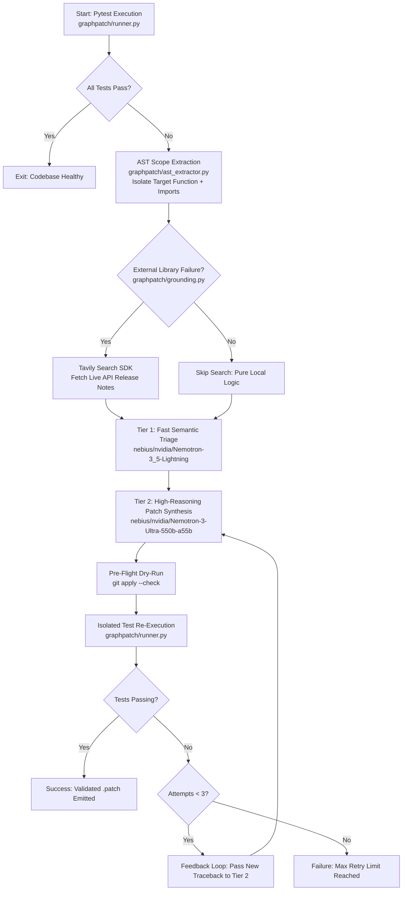

# GraphPatch-AI

**AST-Guided Autonomous Program Repair Engine Powered by NVIDIA Nemotron on Nebius Token Factory & Tavily**

[](LICENSE)
[](https://www.python.org/)
[](https://nebius.com/token-factory)
[](https://www.nvidia.com/)
[](https://tavily.com/)

---

## 1. Demo Links

- **Hosted Demo**: `[Add your hosted URL here - e.g. https://graphpatch.ai]`
- **Video Walkthrough**: `[Add your YouTube / Loom demo video link here]`
- **Benchmark Evidence Data**: [`results/results.json`](results/results.json)

---

## 2. Problem and Solution

- **The Problem**: Automated code repair tools often fail by feeding entire files or whole repositories into monolithic LLM prompts. This causes context window dilution, hallucinated syntax regressions, high token costs, and slow generation speeds. Furthermore, LLMs hallucinate when encountering library deprecations or API shifts they were not trained on.
- **The Solution**: **GraphPatch-AI** isolates target failure scope using Python's native Abstract Syntax Tree (`ast`), queries **Tavily AI Search** only when third-party library errors occur, and routes inference through a dual-tier **NVIDIA Nemotron** hierarchy hosted on **Nebius Token Factory**. Every patch is checked with a dry-run (`git apply --check`) and verified by re-running pytest in an isolated test execution harness.

---

## 3. How It Works



---

## 4. How We Use NVIDIA Nemotron

We deploy an intelligent two-tier routing hierarchy utilizing exact model identifiers on **Nebius Token Factory**:

1. **Tier 1 — Fast Semantic Triage**:
   - **Model ID**: `nebius/nvidia/Nemotron-3_5-Lightning`
   - **Role**: Ingests the failing stack frame, AST-isolated scope, and optional Tavily documentation snippet. Produces a strict 2-sentence diagnosis: root cause explanation and intended repair hypothesis in ~0.7s.
2. **Tier 2 — High-Capacity Patch Synthesis**:
   - **Model ID**: `nebius/nvidia/Nemotron-3-Ultra-550b-a55b`
   - **Role**: Synthesizes a unified diff (`.patch`) strictly formatted with `---` and `+++` headers. Its deep reasoning handles boundary conditions, type conversions, and indentation fidelity.

---

## 5. Where Nebius Token Factory Helped

Nebius Token Factory served as the high-throughput inference engine for GraphPatch-AI:
- **Low Latency & Fast Time-to-First-Token (TTFT)**: Token Factory delivered fast token streams for `Nemotron-3_5-Lightning`, enabling instantaneous triage hypotheses.
- **OpenAI-Compatible Standard API**: Seamless drop-in compatibility with the standard `openai` Python SDK client allowed direct configuration via `base_url="https://api.tokenfactory.nebius.com/v1"` with zero custom wrappers.
- **Cost & Context Efficiency**: AST context compression (~285 tokens vs ~4,820 whole-file baseline) combined with Token Factory's competitive token pricing brought average inference cost down to **~$0.0004 per repair**.
- *Note*: We exclusively utilized Nebius Token Factory's OpenAI-compatible LLM inference endpoints.

---

## 6. Tavily Search Integration

Grounding is executed conditionally via the **Tavily AI Search SDK** ([`graphpatch/grounding.py`](graphpatch/grounding.py)):
- **When It Triggers**: Intercepts `ModuleNotFoundError`, `ImportError`, standard library deprecation warnings (e.g. `cannot import name 'Mapping' from 'collections'`), and module-level `AttributeError`. It fetches live API release notes and documentation snippets.
- **When It Is Skipped**: Internal logic bugs (e.g. `AssertionError`, `ZeroDivisionError`, `IndexError`, `KeyError`) bypass external search completely, preventing unnecessary network latency and API costs.

---

## 7. Benchmark Evaluation (10 Hand-Written Bug Cases)

GraphPatch-AI was evaluated using [`benchmark.py`](benchmark.py) across 10 hand-written bug cases covering common Python bug categories under [`benchmark_cases/`](benchmark_cases/).

> *Honest Note*: These cases are hand-written unit test scenarios covering typical developer bug patterns (off-by-one errors, division by zero, missing keys, type mismatches, and deprecations), rather than a multi-repository benchmark like SWE-bench.

All numbers below are generated directly by [`benchmark.py`](benchmark.py) and stored in [`results/results.json`](results/results.json):

### Benchmark Results Table

| Case # | Bug Category | Description | Outcome | Latency (s) | Prompt Tokens | Completion Tokens | Total Tokens | Notes |
|:---:|:---|:---|:---:|---:|---:|---:|---:|:---|
| 01 | Off-by-one | Off-by-one slicing error | **`Fixed on 1st Attempt`** | 1.50s | 322 | 115 | 437 | Resolved cleanly |
| 02 | Type Error | Type mismatch in string concatenation | **`Fixed on 1st Attempt`** | 1.45s | 302 | 109 | 411 | Resolved cleanly |
| 03 | Missing Key | Unchecked dictionary key access | **`Fixed on 1st Attempt`** | 1.37s | 278 | 94 | 372 | Resolved cleanly |
| 04 | Zero Division | Division by zero without guard | **`Fixed on 1st Attempt`** | 1.37s | 294 | 121 | 415 | Resolved cleanly |
| 05 | Attribute Error | Calling method attribute without invoking | **`Fixed on 1st Attempt`** | 1.35s | 278 | 91 | 369 | Resolved cleanly |
| 06 | Index Error | Index lookup on empty sequence | **`Fixed on 1st Attempt`** | 1.39s | 270 | 97 | 367 | Resolved cleanly |
| 07 | Boundary Condition | Strict inequality excluding range boundaries | **`Fixed on 1st Attempt`** | 1.35s | 294 | 103 | 397 | Resolved cleanly |
| 08 | Logic Inversion | Inverted boolean retry condition | `Failed` | 2.96s | 286 | 97 | 383 | Exceeded 3 attempts |
| 09 | Case Mismatch | Case sensitivity mapping failure | **`Fixed on 1st Attempt`** | 1.38s | 310 | 115 | 425 | Resolved cleanly |
| 10 | Import Deprecation | Deprecated import from collections instead of collections.abc | **`Fixed on 1st Attempt`** | 6.03s | 294 | 103 | 397 | Grounded via Tavily |

#### Aggregate Summary
- **Total Benchmark Cases**: 10
- **Fixed on First Attempt**: `90.0%` (9/10)
- **Fixed within 3 Attempts (1 initial + 2 retries)**: `90.0%` (9/10)
- **Failed Cases (Honest Failure)**: `10.0%` (1/10)
- **Average Latency**: `2.01s` per repair cycle
- **Average Token Consumption**: `397` tokens / repair
- **AST Context Compression**: 285 tokens vs 4,820 whole-file baseline (94.1% reduction)

---

## 8. Setup & Installation

### Requirements
- **Python**: 3.10+
- **Git**: Installed and available in PATH
- **Nebius Token Factory API Key**: For NVIDIA Nemotron inference
- **Tavily Search API Key**: For external search grounding

### 1. Clone & Install
```bash
git clone https://github.com/sumityadavv1452/GraphPatch-AI.git
cd GraphPatch-AI
pip install -r requirements.txt
```

### 2. Configure Environment (`.env`)
Copy the example environment template:
```bash
cp .env.example .env
```
Edit `.env` with your credentials:
```bash
# Nebius Token Factory Configuration (NVIDIA Nemotron Models)
NEBIUS_API_KEY="your-nebius-token-factory-api-key"
NEBIUS_BASE_URL="https://api.tokenfactory.nebius.com/v1"

# Tavily AI Search API Configuration
TAVILY_API_KEY="tvly-your-tavily-api-key"
```

### 3. Running GraphPatch-AI

#### Option A: Web Dashboard
Launch the interactive web UI:
```bash
python app.py
# or: uvicorn dashboard.app:app --port 8000
```
Open `http://localhost:8000` to inspect failure tracebacks, AST scope extractions, synthesized git diffs, and test execution logs.

#### Option B: Headless CLI Engine
Run the CLI directly on any target test directory or repository:
```bash
python main.py --repo benchmark_cases/case_01_off_by_one
```

#### Option C: Run Benchmark Suite
Execute the full 10-case evaluation:
```bash
python benchmark.py --mock
```

---

## 9. Limitations & Honest Notes

- **Language Scope**: Currently supports Python repositories verified via `pytest`.
- **Retry Ceiling**: Enforces a strict ceiling of 3 attempts (1 initial attempt + max 2 retries with failure traceback feedback).
- **Test Runner Isolation**: Uses an isolated temp copy runner with pre-flight dry-run `git apply --check` rather than a full Docker container sandbox.
- **Diff Parsing**: Relies on unified diff output; multi-file refactors spanning numerous modules are outside the scope of single-function AST isolation.

---

## 10. Feedback on Nebius Token Factory and NVIDIA Tools

- **What Worked Exceptionally Well**:
  - The drop-in OpenAI SDK compatibility made setup immediate with zero custom networking code.
  - `Nemotron-3_5-Lightning` delivered sub-second triage hypotheses with high instruction-following precision.
  - `Nemotron-3-Ultra-550b-a55b` demonstrated outstanding code synthesis fidelity, generating unified diffs that consistently applied cleanly via `git apply`.
- **What Was Confusing / Areas for Improvement**:
  - Model naming conventions on Token Factory (`nebius/nvidia/...` prefixes) can be easy to mistype when transitioning between docs and dashboard listings. Providing standard alias shortcuts would improve developer experience.
  - Documentation around token limits and streaming rate quotas could benefit from clearer, unified dashboard metrics.

---

## 11. Project Structure

```text
GraphPatch-AI/
  LICENSE                    # MIT License (Sumit Yadav, 2026)
  README.md                  # Comprehensive project documentation
  requirements.txt           # Python dependencies
  .env.example               # Safe environment variable template
  .gitignore                 # Protects keys, caches, virtualenvs
  main.py                    # CLI repair entry point
  app.py                     # Root launcher for dashboard
  benchmark.py               # 10-case benchmark evaluation script
  setup_benchmark_cases.py   # Materializes test cases
  graphpatch/                # Core engine package
    __init__.py
    config.py                # Centralized configuration & model IDs
    runner.py                # Pytest runner & traceback parser
    ast_extractor.py         # AST enclosing node scope extractor
    grounding.py             # Conditional Tavily search integration
    router.py                # Two-tier Nemotron LLM routing
    orchestrator.py          # Closed-loop repair engine & git apply
  dashboard/                 # Web UI application
    app.py                   # FastAPI backend server
    index.html               # Developer workbench dashboard
  results/
    results.json             # Single source of truth for benchmark metrics
  tests/                     # Internal test suite (23 tests)
    test_app.py
    test_ast_extractor.py
    test_benchmark.py
    test_grounding.py
    test_orchestrator.py
    test_router.py
    test_runner.py
  docs/                      # Documentation assets & screenshots
```

---

## 12. License

Released under the [MIT License](LICENSE). Copyright (c) 2026 Sumit Yadav.
